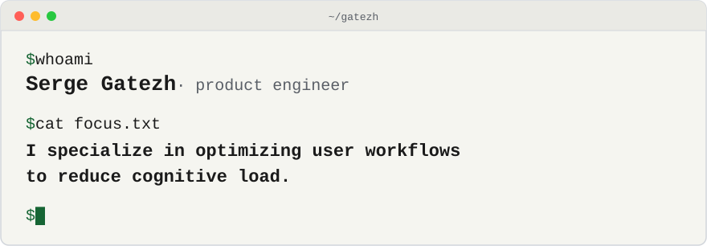

<picture>
  <source media="(prefers-color-scheme: dark)" srcset="./assets/banner-dark.svg">
  
</picture>

I'm Serge, a product engineer. I build simple, secure software end to end, and write about what I learn along the way. I specialize in optimizing user workflows to reduce cognitive load.

**Right now** I'm writing part 2 of [Protecting SSH Keys with macOS Secure Enclave](https://gatezh.com/posts/macos-secure-enclave-ssh-keys/), which made the [Hacker News front page](https://news.ycombinator.com/item?id=50449748). It's about [Secretive](https://github.com/maxgoedjen/secretive), the app I ended up using.

#### Latest from gatezh.com

<!-- posts:start -->
- [Docker Desktop Disk Full on macOS: The 1 TB Default and the Dev Containers Cache](https://gatezh.com/posts/docker-desktop-disk-full-macos/) · Sep 2026
- [Protecting SSH Keys with macOS Secure Enclave (Native Approach)](https://gatezh.com/posts/macos-secure-enclave-ssh-keys/) · Feb 2026
- [Publishing Multi-Platform Docker Images to GitHub Container Registry](https://gatezh.com/posts/publishing-multi-platform-docker-images-to-github-container-registry/) · Dec 2025
- [Add Remark42 comments to Hugo website](https://gatezh.com/posts/add-remark42-comments-to-hugo-website/) · Jun 2024
<!-- posts:end -->

#### Also

- [devcontainers](https://github.com/gatezh/devcontainers): dev container images for AI coding assistants, with a firewall sandbox so the agent can't reach what it shouldn't.
- [Talks](https://gatezh.com/talks/): I run the Frontend & Beyond meetup in Calgary and speak about shipping on Cloudflare's free tier and keeping AI agents away from secrets.

[gatezh.com](https://gatezh.com) · [LinkedIn](https://linkedin.com/in/gatezh) · [Hacker News](https://news.ycombinator.com/user?id=gatezh) · [RSS](https://gatezh.com/index.xml)
